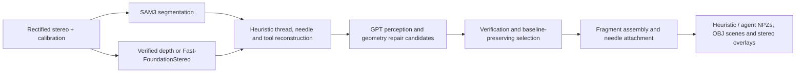

# Surgical Scene Pipeline

Reconstruct a stereo surgical snapshot as **thread fragments, a rigid needle arc and articulated distal tool meshes**. The pipeline preserves a heuristic baseline and uses GPT-6.1 Sol to propose and review repairs as separate candidates.

This is a research pipeline for static snapshots. Processing completion, geometric consistency and independently measured reconstruction accuracy are separate outcomes.



## What is included

- A command-line workflow for preparing, submitting, running, reviewing and collecting scenes.
- Fine-tuned SAM3 integration, stereo depth, thread reconstruction, rigid needle fitting and attachment proposals.
- Native `online_dvrk_tracking_clean` Bayesian initialization and CMA-ES tool fitting.
- **VLM-generated observations of the two distal jaw tips** for each tool. The tracker computes their midpoint internally; this release does not use the newer yaw/anchor optimizer or custom tool-pose refiners.
- Separate heuristic and agent outputs, partial fragments, failed candidates, source hashes, fitted joint angles and full-view stereo overlays.
- An unattended sequential runner with scene watchdogs, charged-attempt budgets and protection against duplicate submissions or silent replay.

The supported full-pipeline launcher uses **GPT-6.1 Sol**. Earlier Gemma landmark experiments are not presented here as a validated end-to-end Gemma backend.

## Repository layout

```text
scene_pipeline/                 Public CLI, preparation, runner and exporters
├── resources/                  Pinned native-dependency hashes
└── runtime_template/           Versioned reconstruction compatibility sources
examples/                       Configuration and standalone scene-manifest examples
environment/                    CUDA runtime recipe and recorded dependency versions
docs/                           Configuration, architecture, outputs and deployment
scripts/                        Repository-content checks
tests/                          CPU tests and an optional read-only export smoke test
provenance/                     Original release provenance and validation records
.github/workflows/ci.yml        CPU-only source checks
```

`runtime_template/` preserves the reconstruction sources used by the tested pipeline. Its historical standalone scripts are compatibility internals; use the public CLI rather than invoking them directly. Research data, annotations, model weights, containers and generated reconstructions are external to this repository.

## Requirements

- Python **3.10+** for the control commands.
- A Linux reconstruction server with **Slurm and Apptainer**. GPU inference runs inside a scheduler allocation.
- A compatible CUDA environment; the tested Blackwell environment requires **CUDA 12.8+**.
- External SAM3, Fast-FoundationStereo and native-tracker assets, plus an OpenAI API credential for the GPT run.

The Python control package does not install the GPU stack. `environment/Dockerfile.cuda128` records the extensions to the laboratory's external `med3d:cu128` base. `environment/validated-freeze.txt` is a record of that environment, **not a portable pip requirements file**. See [deployment](docs/deployment.md) and [third-party components](THIRD_PARTY.md).

## Quick start

Clone the repository on the reconstruction server:

```bash
git clone https://github.com/HitarthSS/surgicalreal2sim2real.git
cd surgicalreal2sim2real
```

Run the following commands from the repository root:

```bash
cp examples/config.json config.local.json
cp examples/manifest.json manifest.local.json
```

Edit both files with your own asset paths, camera calibration and input-image hashes. The example baseline is illustrative and must be replaced with your measured stereo baseline. Add paths outside `/data` to `bind_paths`.

```bash
python3 -m scene_pipeline doctor config.local.json
python3 -m scene_pipeline prepare manifest.local.json config.local.json /data/youruser/runs/run01
python3 -m scene_pipeline submit /data/youruser/runs/run01
python3 -m scene_pipeline credential /data/youruser/runs/run01
```

The final command prompts invisibly for the API key and starts a detached **server RAM relay**. The credential is not stored in a file, command argument or container configuration. Once submitted, execution does not depend on this chat or an open SSH connection. Scheduler availability still determines when the job starts.

The submission defaults are one GPU shard, eight CPUs, 40 GiB RAM and a 12-hour limit. If your cluster uses different resources, adapt `scene_pipeline/submit.py` before submitting. Do not submit a second job just because the first is pending.

See [configuration and input schema](docs/configuration.md) for standalone inputs and [deployment and recovery](docs/deployment.md) for cluster usage.

## Outputs and status

A prepared run contains:

```text
run01/
├── progress.json                Terminal attempts and component errors
├── queue_complete.json          All scenes reached a terminal processing state
├── gpt/dayYYYYMMDD/SCENE/        Baselines, candidates, logs and stage receipts
├── review/gallery.html          Heuristic and agent stereo overlays
└── reconstructions/
    └── GPT61_Reconstructions/
        ├── heuristic/SCENE/
        └── agent/SCENE/
```

Each available reconstruction includes geometry NPZs, an inspection OBJ, observations and calibration, and fitted distal tool angles in JSON and NPZ. Disconnected thread fragments remain visible and separately represented. See the [output contract](docs/outputs.md).

A failed scene does not discard previous scenes or stop the remaining queue. Completed or interrupted charged scientific attempts are **not silently replayed**. Packaging failures are indexed and partial collections are marked incomplete.

## Validation

CPU-only checks require neither GPU assets nor API access:

```bash
PYTHONDONTWRITEBYTECODE=1 python3 -m unittest discover -s tests -v
python3 scripts/check_repository.py
```

The original source release passed a ten-scene preparation/import preflight and a read-only export test on one existing scene: two controller packages, four tool joint-angle NPZs and ZIP integrity were checked. That smoke test did not perform new reconstruction inference. The GitHub preparation adds tests for explicit metadata paths, immutable input hashes and preservation of existing output directories. Historical evidence is recorded under `provenance/`; it does not certify every new dataset or machine.

## Scientific limits

- Tool fitting uses the left camera; the right projection is a consistency check, not a joint stereo optimization objective.
- Geometry checks and mask overlap are not independent 3D accuracy measurements.
- Tool IDs are visual instances, not calibrated PSM identities. Distal fitted angles and recorded full robot states are kept separate.
- Metric scale, material properties and camera-to-robot transforms remain provisional or unavailable.
- These exports have not undergone Newton motion validation and are not imitation demonstrations.

## Sharing and licensing

The pipeline CLI does not configure Git remotes or publish changes. [GitHub workflow](docs/github.md) describes reviewing and pushing source changes.

No repository-wide open-source license has been assigned. The bundled compatibility sources and external dependencies retain their original terms; see [the licensing notice](LICENSE_NOTICE.md) and [third-party inventory](THIRD_PARTY.md).
